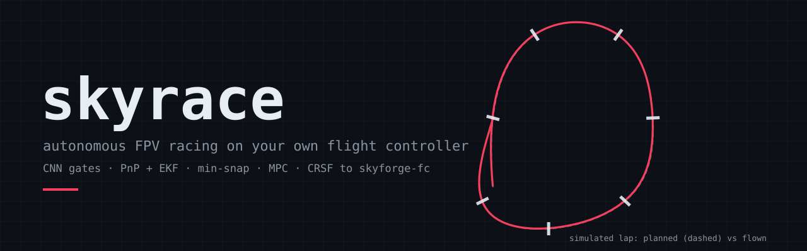
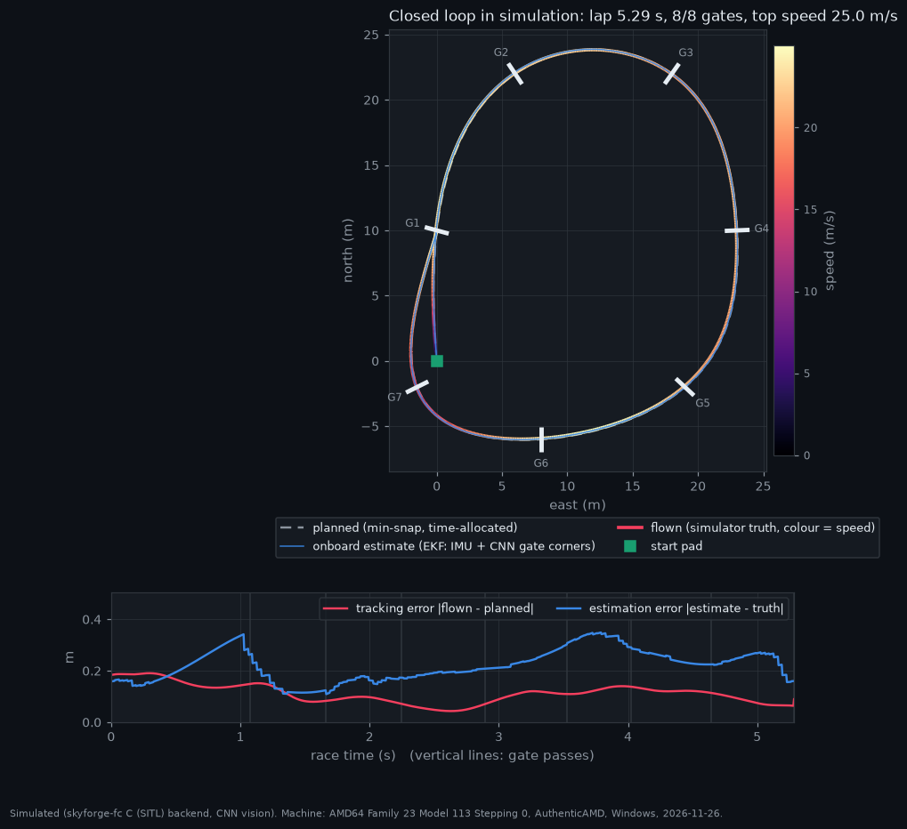
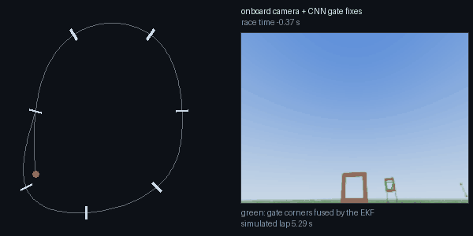
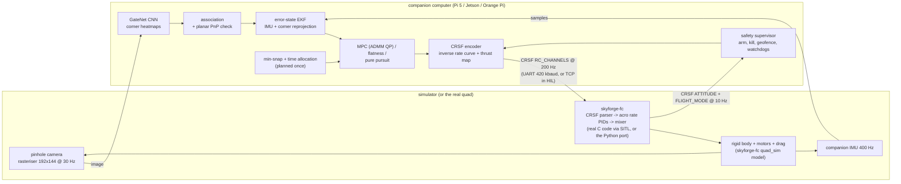
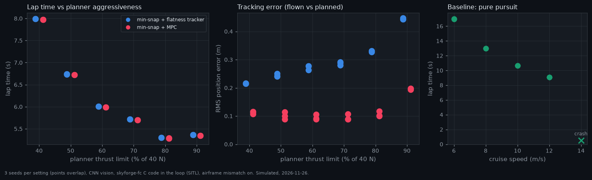
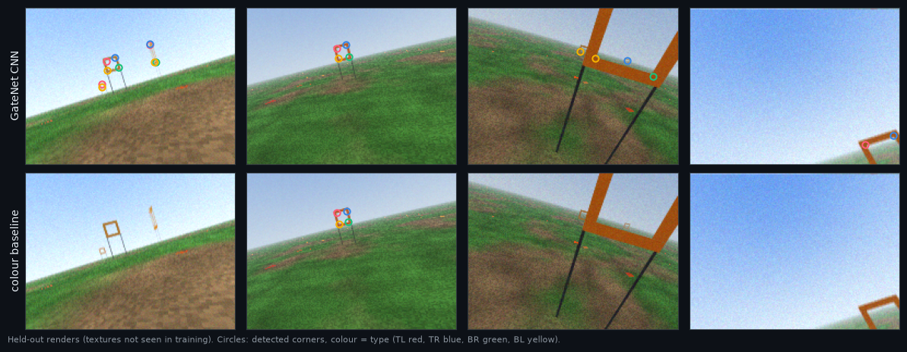

<p align="center"></p>

<p align="center">
  <a href="https://github.com/coopersimpson101-debug/skyrace/actions/workflows/ci.yml"></a>
  <a href="https://github.com/coopersimpson101-debug/skyrace/releases"></a>
  <a href="LICENSE"></a>
  
  
  
</p>

**skyrace** races an FPV quad through gates on its own flight controller: a small CNN finds the gates,
an EKF fuses them with the IMU, a time-allocated minimum-snap plan is tracked by an MPC, and the companion
computer talks to [skyforge-fc](https://github.com/coopersimpson101-debug/skyforge-fc) in plain CRSF RC frames,
exactly as a radio receiver would. Everything below is simulated (🧪); real-drone flights are still to do (⏳).

[How it works](#how-it-works) · [Results](#results) · [Algorithms](docs/algorithms.md) ·
[Hardware & safety](docs/hardware.md) · [Hardware validation / TODO](#hardware-validation--todo-for-the-author)

<p align="center">
  
  
</p>
<p align="center"><sub>🧪 One closed-loop lap in simulation: CNN vision → EKF → MPC → CRSF bytes → <b>the real skyforge-fc
C code</b> (8 kHz gyro / 4 kHz PID, via SITL) → rigid-body physics with a deliberately wrong airframe model
(mass +8 %, thrust −5 %, drag +33 %). Lap 5.29 s, 8/8 gates, 25.0 m/s top speed, RMS tracking error 0.12 m,
RMS estimation error 0.23 m. Generated by <code>scripts/run_race.py</code> + <code>docs/assets/make_figures.py</code>
on an AMD Ryzen 5 3600 (Windows), 2026-11-26.</sub></p>

## Highlights

- **Closes the whole loop on the real FC code.** A 205-line C shim compiles skyforge-fc's `src/core` and
  `sim/quad_sim.c` unmodified and feeds them the companion's raw CRSF bytes; telemetry comes back as
  CRSF ATTITUDE / FLIGHT_MODE frames. 65 of the 66 simulated laps in the results were flown this way; a Python
  port of the FC core (matching the C PID / mixer / CRSF to 1e-4 in tests) runs the rest and CI.
- **Hand-written vision, no frameworks.** GateNet (74.5 k parameters) is trained with backprop written in numpy
  (gradient-checked); on 600 held-out renders it finds **91.4 %** of gate corners within 4 px (median error
  0.90 px) vs **57.2 %** for a colour/hole-corner baseline.
- **Time-optimal-ish planning.** Closed-form minimum snap with a time allocation that minimises lap time
  subject to thrust, body-rate and speed limits; laps from 7.98 s down to 5.29 s as the thrust limit rises.
- **MPC on an ADMM QP solver written here** tracks the plan about 2-3x more tightly than a flatness controller
  (RMS 0.09-0.20 m vs 0.22-0.45 m) and is 1.7x faster than the best clean pure-pursuit lap (5.29 s vs 9.10 s).
- **Byte-exact CRSF + safety.** Inverse rate curve / deadband / thrust map, CRC-8/DVB-S2 frames, arming
  sequence, latched kill (FC disarmed ≤ 25 ms after the kill in tests), geofence, estimator / vision /
  telemetry watchdogs, and the FC's own 300 ms RX-loss failsafe.
- **Hardware-in-the-loop over TCP** with the same bytes; the HIL run reproduces the in-process run bit for bit.

## Status

| Component | Status | Evidence |
|---|---|---|
| CRSF encode/parse, CRC, channel packing (vs skyforge-fc C) | ✅ | `tests/test_crsf.py`, `tests/test_commands.py` |
| Python port of FC core (PID, mixer, rate curve, arming, failsafe) | ✅ | `tests/test_fc_port.py` (vs C via ctypes) |
| SITL: real skyforge-fc C code driven by CRSF bytes | ✅ | `tests/test_closed_loop.py` |
| Renderer, GateNet training + inference, classical baseline | ✅ | `tests/test_vision.py`, `results/detector_eval.json` |
| Planar PnP, error-state EKF | ✅ | `tests/test_vision.py`, `tests/test_planning_control.py` |
| Minimum snap + time allocation, ADMM QP, MPC | ✅ | `tests/test_planning_control.py` |
| Safety supervisor (arm, kill, geofence, watchdogs) | ✅ | `tests/test_closed_loop.py` |
| HIL mode over TCP (lockstep, bit-identical) | ✅ | `tests/test_closed_loop.py::test_hil_over_tcp_matches_in_process` |
| Lap times, pass rate, planned-vs-flown plot | 🧪 | `results/race_results.json`, figures above |
| Serial bridge on Pi 5 / Jetson / Orange Pi | ⏳ | code in `skyrace/link/bridge.py`, never run on hardware |
| Camera + IMU drivers on the companion | ⏳ | not written yet |
| Real-drone lap video | ⏳ | — |

## Quickstart

```bash
git clone https://github.com/coopersimpson101-debug/skyrace && cd skyrace
pip install -e ".[dev,figures]"
python -m pytest -q                                   # ~2 min, no GPU, no compiler needed
python scripts/run_race.py --quick --backend python   # one closed-loop lap: CNN vision + EKF + MPC
python scripts/build_sitl.py --skyforge-fc ../skyforge-fc && python scripts/run_race.py --quick --backend sitl
```

Runtime dependency: numpy only (matplotlib + Pillow for figures, pyserial for the real UART). Third-party
tools used to produce this repo, all from their official sources: `ziglang` from PyPI as the C compiler for
the SITL library (any `cc`/`gcc` works: `CC=gcc python scripts/build_sitl.py ...`), and `@resvg/resvg-js` from
npm to rasterise `docs/assets/banner.svg` to PNG. No datasets are downloaded: every training and test image is
rendered by `skyrace/sim/camera.py`.

## How it works



The full derivations are in [docs/algorithms.md](docs/algorithms.md); the short version:

<details>
<summary><b>Vision: GateNet + planar PnP</b></summary>

A 7-layer fully-convolutional network (74.5 k parameters) predicts four corner
heatmaps (TL/TR/BR/BL of the gate opening, in the gate's own frame) at stride 4.
It is trained here on synthetic renders with CenterNet's penalty-reduced focal
loss; **forward and backward passes are hand-written numpy** (im2col GEMMs,
col2im, upsample/skip gradients), gradient-checked against finite differences.
Detections are associated with the corners predicted from the EKF prior; a
planar PnP (normalised DLT homography → SO(3) projection → Levenberg–Marquardt,
with a `σ²(JᵀJ)⁻¹` covariance) validates the four-point association and gives the
per-gate pose used in the detector evaluation.
</details>

<details>
<summary><b>Estimation: error-state EKF</b></summary>

15-state error-state EKF (position, velocity, attitude, gyro and accel bias)
propagated with the companion IMU at 400 Hz. Gate measurements are fused
*tightly coupled*: the residual is the four corner pixels against their
projection from the current estimate (analytic Jacobian w.r.t. position and the
body-frame attitude error), with a χ² gate. Fusing the PnP pose instead
(`ekf_update="pnp"`) is also implemented; at 10–20 m a single 1.4 m gate is
13–26 px wide and planar PnP is dominated by the rotation/translation
ambiguity, which made the loosely coupled filter overconfident in testing.
insight-vio's MSCKF is not used: with a known gate map every fix is absolute,
so no feature states are needed.
</details>

<details>
<summary><b>Planning: closed-form minimum snap + time allocation</b></summary>

Degree-7 segments through the start hover point and the gate centres in race
order. The unconstrained QP is solved in closed form (`D_P* = −R_PP⁻¹ R_PF D_F`,
Richter–Bry–Roy). Time allocation: because uniform time scaling keeps the path,
the lap time for segment-time *ratios* r is `α*(r)·Σr`, where α* is the smallest
scale (bisection) that keeps collective thrust (with linear drag), body-rate
magnitude (from flatness) and speed within limits. Lap time is then minimised
over log r by gradient descent with backtracking.
</details>

<details>
<summary><b>Control: LTV-MPC with a hand-written ADMM QP, flatness tracker, pure pursuit</b></summary>

The MPC linearises the quadrotor about the reference along a 16 × 40 ms horizon
(error state δp, δv, δθ with `R = R_ref exp([δθ]×)`, inputs δT, δω), condenses the
problem and solves it at 50 Hz with an OSQP-style ADMM solver written here
(relaxation, ρ adaptation, warm start), with box constraints on thrust and body
rates. The flatness tracker uses the same reference with PD position feedback
and a proportional attitude loop. The baseline pure pursuit chases a look-ahead
point on the polyline through the gates at a fixed cruise speed. All three
output collective thrust + body rates.
</details>

<details>
<summary><b>Link: CRSF exactly as skyforge-fc parses it</b></summary>

skyforge-fc in acro maps sticks with `rc_rate_curve` (after a deadband) and
passes throttle to the mixer. The companion inverts that chain (safeguarded
Newton on the odd, monotone rate curve; exact deadband inverse; thrust → throttle
from the motor law), packs 16 × 11-bit channels LSB-first into a 0x16 frame with
CRC-8/DVB-S2 (poly 0xD5) and writes it at 200 Hz. AUX1 is the arm switch
(> 1700 µs), AUX2 angle mode (> 1300 µs). The same bytes go to a serial port
(`SerialUart`) or, in hardware-in-the-loop mode, over a TCP socket to the
simulator process; the HIL protocol is lockstep, and the test suite checks that
a HIL flight is bit-identical to the in-process one.
</details>

## Results

All numbers below are 🧪 simulation, produced on an AMD Ryzen 5 3600 / Windows 10 on 2026-11-26 by the
scripts named, and stored in [`results/`](results). The simulated quad uses the real skyforge-fc C code
(SITL) and an airframe that differs from the companion's model (mass 0.70 vs 0.65 kg, 9.5 vs 10 N per motor,
drag 0.20 vs 0.15 N·s/m). Track `loop7`: 7 gates (1.4 m opening), a standing-start lap from a 1.5 m hover
through all gates and back through gate 1, ~95 m. Each setting was flown with 3 noise seeds; the
simulator is deterministic per seed, so the seed-to-seed spread is below 10 ms.

### Lap time, gate pass rate and tracking (CNN vision, `scripts/run_race.py`)

| Controller | Setting | Lap (s) | Gates passed | RMS tracking error (m) | RMS estimation error (m) | Top speed (m/s) |
|---|---|---|---|---|---|---|
| min-snap + MPC | thrust limit 40 % | 7.98 | 24/24 | 0.11 | 0.11 | 16.2 |
| min-snap + MPC | 60 % | 5.99 | 24/24 | 0.10 | 0.19 | 21.9 |
| min-snap + MPC | **80 %** | **5.29** | 24/24 | 0.11 | 0.23 | 25.0 |
| min-snap + MPC | 90 % | 5.35 | 24/24 | 0.20 | 0.23 | 25.1 |
| min-snap + flatness tracker | 40 % | 7.99 | 24/24 | 0.22 | 0.11 | 16.1 |
| min-snap + flatness tracker | 60 % | 6.01 | 24/24 | 0.27 | 0.18 | 21.8 |
| min-snap + flatness tracker | **80 %** | **5.30** | 24/24 | 0.33 | 0.23 | 24.8 |
| min-snap + flatness tracker | 90 % | 5.37 | 24/24 | 0.45 | 0.22 | 24.9 |
| pure pursuit (baseline) | 8 m/s | 12.98 | 24/24 | – | 0.05 | 7.9 |
| pure pursuit (baseline) | **12 m/s** | **9.10** | 24/24 | – | 0.08 | 11.7 |
| pure pursuit (baseline) | 14 m/s | crash ×3 | 21/24 | – | 0.09 | 13.7 |

<p align="center"></p>

What this shows, and what it does not:

* **Every min-snap/MPC and min-snap/flatness lap passed all 8 gates** (36/36 laps, 288/288 gate passes); pure
  pursuit passed 117/120 gates and crashed into gate 1's frame on the final crossing at 14 m/s.
* With the same plan the two trackers give the same lap time (it is set by the planner); the MPC holds the
  plan about 2-3x more tightly under the airframe mismatch, which is what keeps the margin to the 0.58 m gate
  clearance. Pushing the thrust limit from 80 % to 90 % did not help: the time allocation is a local
  optimiser and hits the 25 m/s speed cap, and tracking degrades (0.6 m worst case for the MPC).
* Lap time is a standing start. Planned laps: 7.98 / 6.72 / 6.00 / 5.70 / 5.29 / 5.35 s for 40-90 %; flown laps
  match them to < 20 ms.
* The Python port of the FC core flies the same lap (MPC, 60 %) in 5.996 s vs 5.993 s on the C code.

### Vision ablation (MPC, 1 seed per setting)

| Gate measurements from | Laps clean | RMS estimation error (m), 40-90 % | RMS tracking error (m) |
|---|---|---|---|
| ground truth pose (σ = 5 cm, 1°) | 6/6 | 0.07-0.11 | 0.08-0.26 |
| **GateNet CNN** | 18/18 | 0.11-0.23 | 0.10-0.20 |
| classical colour baseline | 6/6 | 0.31-0.38 | 0.24-0.33 |

### Gate detector on held-out renders (`scripts/eval_detector.py`, 600 images, textures not used in training)

| | GateNet CNN | colour + hole-corner baseline |
|---|---|---|
| corner recall (≤ 4 px, corners < 15 m) | **91.4 %** | 57.2 % |
| median / p90 pixel error of matched corners | 0.90 / 1.74 px | 0.97 / 1.99 px |
| false positives per image | 0.18 | 0.41 |
| 4-corner association + PnP success (gates < 12 m) | 79.4 % | 77.3 % |
| single-gate PnP range error, median: 0-4 / 4-8 / 8-12 m | 0.04 / 0.16 / 0.29 m | 0.11 / 0.26 / 0.54 m |
| single-gate PnP position error, median: 0-4 / 4-8 / 8-12 m | 0.21 / 1.04 / 2.84 m | 0.17 / 0.75 / 2.07 m |
| time per 192×144 frame (numpy, 2 BLAS threads, shared machine) | 57 ms | 131 ms |

<p align="center"></p>

Two honest caveats. (1) The baseline's recall is partly low because it types corners by image position, which
breaks in banked turns; in the closed loop it is therefore associated type-agnostically. (2) A single 1.4 m gate
gives an excellent *range* but a poor *position* at > 4 m: the rotation/translation ambiguity of a small planar
target. That is why the EKF fuses the corner pixels directly (with the IMU attitude prior) instead of the PnP
pose; the PnP solve is kept to validate the four-point association. GateNet was trained on 8000 renders for
6 epochs (74,516 parameters, 71 min on 3 CPU threads, `results/train_log.json`).

## Hardware validation / TODO for the author

Nothing here has run on hardware. Exact steps (see [docs/hardware.md](docs/hardware.md) for wiring and the
safety architecture):

```bash
# 0. companion: Pi 5 (or Jetson / Orange Pi), PROPS OFF
pip install -e ".[serial]"
python scripts/companion_main.py --port /dev/ttyAMA0 --bench          # FC CLI `status`: no RX_LOSS
python scripts/companion_main.py --port /dev/ttyAMA0 --bench --arm    # FC arms at zero throttle; Enter = kill
# 1. thrust stand: fit AirframeModel.thrust_max / motor_idle; 2. calibrate the camera (fx, uptilt)
# 3. write camera + IMU drivers that feed CompanionStack.tick(); 4. tethered hover; 5. one gate; 6. full track
```

| Check | Result | Date |
|---|---|---|
| CRSF frames accepted by skyforge-fc on the bench (`frames_ok`, no `crc_errors`) | ⏳ | |
| arm → kill latency, logic analyser on the FC UART + DShot | ⏳ | |
| FC RX-loss failsafe when the companion cable is pulled | ⏳ | |
| GateNet on real camera frames: corner recall / pixel error | ⏳ | |
| companion loop rate on Pi 5 / Jetson (CNN + EKF + MPC), ms | ⏳ | |
| tethered hover tracking error | ⏳ | |
| real-drone lap time, gate pass rate, video | ⏳ | |

## Roadmap

- Camera / IMU drivers for Pi 5 (libcamera + SPI IMU) and Jetson (Argus), with timestamp alignment
  (insight-vio's `hw/timesync.py` is the starting point).
- Delayed-measurement handling in the EKF (the sim currently has zero camera latency).
- Fuse insight-vio MSCKF odometry between gates for long gate-free stretches.
- Gate-visibility (perception-aware) constraints in the time allocation; progress-based MPC (MPCC).
- Sim-to-real for GateNet: real-image fine-tuning, int8 inference.

## License

MIT, see [LICENSE](LICENSE). Copyright (c) 2026 the skyrace authors.
